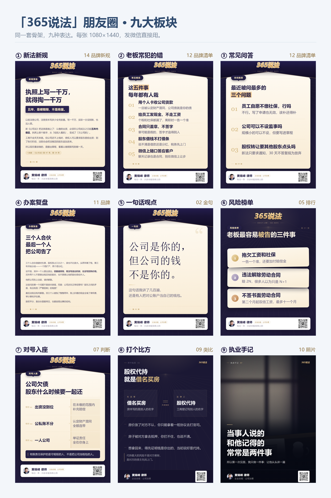
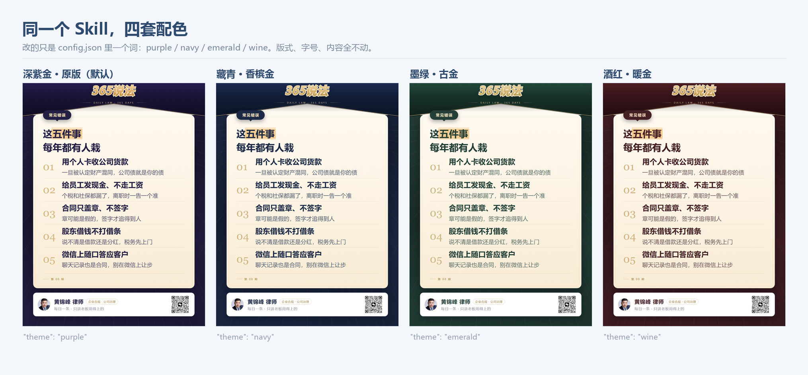
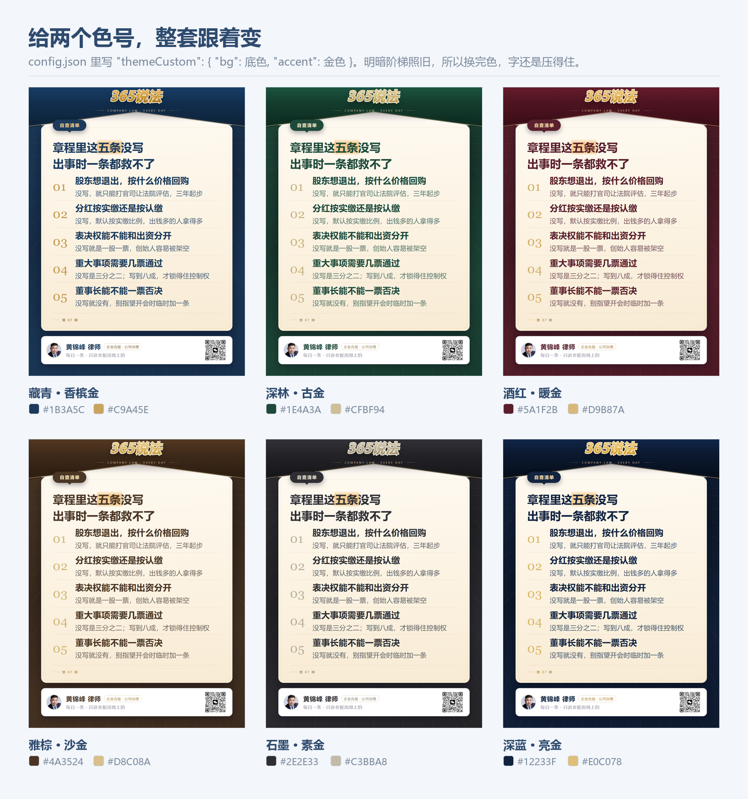

# 律师朋友圈卡片

说一句「今天想讲讲股东会决议」，它直接给你 **朋友圈正文 + 评论区引导语 + 一张能发的卡片图**。

**不用装任何软件。** 图片是用你电脑上已有的 Microsoft Edge 渲染的，全程离线，不联网。



---

## 它一次给你四样东西

| | 交给你什么 | 你还要做什么 |
|---|---|---|
| 1 | 三个标题，附一句话点评 | 挑一个 |
| 2 | 朋友圈正文，40–100 字，四句话 | 复制粘贴 |
| 3 | 评论区第一条引导语 | 发完自己补在评论区 |
| 4 | 1080×1440 卡片图 | 保存到手机 |

**正文里不会出现「私聊我」「加微信」。** 导流全部放评论区——正文带这些词会被限流，而且显得太急着做生意。

---

## 安装（三分钟）

### 方式一：一行命令（推荐，需要电脑上有 git）

按 `Win + R`，输入 `powershell` 回车，粘贴下面这条：

```powershell
git clone https://github.com/XJHwxjb/lawyer-cards.git "$env:USERPROFILE\.workbuddy\skills\lawyer-cards"
```

### 方式二：下载压缩包

1. 点这个仓库右上角绿色 **Code** → **Download ZIP**
2. 解压，得到一个 `lawyer-cards-main` 文件夹
3. 把它**改名**成 `lawyer-cards`
4. 整个文件夹移动到：`C:\Users\你的用户名\.workbuddy\skills\`
   （`.workbuddy` 前面有个英文句点，是隐藏文件夹，直接往地址栏粘贴路径就能进）

### 方式三：已经下载好了，跑一下安装脚本

在文件夹里右键 →「在终端中打开」，输入：

```powershell
powershell -ExecutionPolicy Bypass -File .\install.ps1
```

它会自动把这个文件夹放到正确位置，并帮你生成 `config.json`。

---

## 然后填上你的名字

第一次用的时候，AI 会主动问你两件事：

> 您的署名怎么写？（例如：黄锦峰 律师）擅长哪块业务？（例如：企业合规 · 公司治理）

回答完它自动写进 `config.json`，以后不再问。

想自己改也行：用记事本打开 `config.json`，改 `name` 和 `org`，把 `_configured` 改成 `true`。

**换成自己的头像和二维码**（不换也能用，只是显示占位图）：
- 头像：方形照片，改名 `avatar.png`，覆盖 `assets\avatar.png`
- 二维码：微信「我 → 二维码名片」保存，改名 `qr.png`，覆盖 `assets\qr.png`

两张图都**不要用透明背景**，深色签名条上会发灰。

---

## 怎么用

在 WorkBuddy 里直接说人话就行：

> 今天想讲讲，股东退出没写进章程会怎样

> 帮我做张卡片，讲讲竞业限制

> 新公司法五年实缴，这个选题怎么写？

> 今天发什么？（它会按你的业务方向主动给三个选题）

它会先给三个标题让你挑，选定后出图。图在 `output\` 目录里，同目录还有一份 `文案-xxx.txt`。

---

## 九大板块，各有一张版式

律师每天要发的东西，其实就九种。你只管说选题，AI 自己认板块、选版式。


| 板块 | 什么时候发 | 用哪张 |
|---|---|---|
| ① 新法新规 | 只讲**一条**新规 | 14 品牌新规（大字 + 人话讲透） |
| ① 新法新规 | **盘点**好几条改了的地方 | 13 品牌对照（左右两栏） |
| ② 老板常犯的错 | 想戳痛点，带点恐惧 | 12 品牌清单 |
| ③ 常见问答 | 客户真问过的问题 | 12 品牌清单 |
| ④ 办案复盘 | 手上刚结的案子 | 11 品牌 |
| ⑤ 一句话观点 | 只想表态，不解释 | 02 金句 |
| ⑥ 风险榜单 | 「最容易出事的三个」 | 05 排行 |
| ⑦ 对号入座 | 「你是不是这种情况」 | 07 判断 |
| ⑧ 打个比方 | 概念太抽象，要翻译 | 09 类比 |
| ⑨ 执业手记 | 有照片，想发感悟 | 10 照片 |

**新法新规为什么是两个版式？** 一句话：「这条新规到底什么意思」用 14，「新公司法都改了哪些」用 13。
前者一张卡只讲一条、讲透；后者一张卡并列 3–4 条，当速查表用。选错了会很难看——13 只填两行会空掉下半张。

**九张是同一套骨架**：深紫底 + 放射光线 + 悬浮奶油面板 + 白色签名卡。
连着发，像一本持续更新的专栏，不像九个人做的图。

顶部是**信封式头部**：深色封套的底边压成一道折线（V 字口），奶油面板的顶边做成同斜率的尖顶，从信封口里探出来；沿折线压一条金色缝线。整幅一条连续的折线，不是两段拼的。

品牌字不是普通文字，是一枚**倾斜的金属字标**——金色渐变、米白细描边、深色外轮廓、右下投影，改名字就自动重画。签名卡上的二维码是你自己那张。

---

## 想换颜色？

版式、字号、留白一个字不动，只换颜色。四套现成的，改 `config.json` 里一个词：



| `"theme":` | 观感 | 适合 |
|---|---|---|
| `"purple"` | 深紫 + 香槟金（默认，就是上面那些图） | 通用，辨识度最高 |
| `"navy"` | 藏青 + 香槟金 | 最稳，金融、公司业务、商事诉讼都压得住 |
| `"emerald"` | 墨绿 + 古金 | 沉稳，家事、财富传承、常年顾问 |
| `"wine"` | 酒红 + 暖金 | 情绪重，刑事、人身损害、婚姻 |

任意色号也能自己配，给两个颜色就行：

```json
"themeCustom": { "bg": "#1B3A5C", "accent": "#C9A45E" }
```

`bg` 是底色，`accent` 是金色线条和序号。只填一个也行，另一个保持默认。

下面这六张就是只改这两个色号做出来的，版式一模一样：



或者干脆跟 AI 说人话：「底色换成墨绿，金色淡一点，接近香槟」——它会自己折成两个色号。

**三条边界，先说清楚**：

1. 深色底 + 奶油面板是这个设计的骨架。换的是「哪种深色」，不是「要不要深色」。想要整张白底黑字，那是另一套版式，换个色号到不了。
2. 底色填太浅（比如 `#F0F0F0`），程序只借它的色相、明暗不动，卡面还是深的，同时提示一句。
3. 金色和底色色相太近（相差不到 14°），金线会糊进背景里，也会提示。金色落在 35–50°（香槟、沙金）最稳。

---

## 文案长什么样

九个板块各配一段正文、一条评论区引导语。完整版在 [`examples/朋友圈文案样例册.pdf`](examples/朋友圈文案样例册.pdf)，四页，可以直接打印出来对着写。

**正文四句话**：场景 → 反差 → 后果 → 邀请。40–100 字，通篇不出现「第 X 条」。

**评论区是第二个钩子**：给一个能拿走的具体东西（一份表、一份清单、一次对号、一个扣字），不写「欢迎咨询」。

以 ① 新法新规 为例，正文是这样：

> 上周有个老板问我：公司注册五年了，一分钱没实缴，会不会有事。
> 我说，以前没事，现在不一定了。
> 新《公司法》要求五年内缴足，写在执照上的数字，从「给人看的」变成了「欠公司的」。
> 章程里写「长期」的，建议这个月就改。

评论区第一条：

> 最容易漏的一条：章程写「长期」不等于不用缴。想自查的，评论区扣「期限」，我把这份期限对照表发你。

这套写法不是凭感觉来的。书里第 161 页贴了一位律师照抄法条的正文，点评是「客户看到的什么样？和法官不多」；第 160 页被当范例的卡，标题是「1 秒判断自己的公司是否需要实缴」——给判断标准，不给知识点；第 263 页那位律师，发完正文自己在评论区写「留言『第一关选1，第二关选2…』或私信我，全部答对有惊喜礼品」。

## 另外五张备用版式

满宽分区、编辑排版，调色板一样但骨架不同。穿插发没事，连着发会显得不统一。

| 编号 | 长什么样 | 什么时候用 |
|---|---|---|
| 01 | 满宽分区 + 编号条目 | 6 条以上的长清单 |
| 03 | 左侧深色竖带，「以为」vs「其实」 | 只讲一对误解 |
| 04 | 上半封面 + 下半双栏杂志正文 | 要拆成多张连载的案子 |
| 06 | 深底金晕，右下角数字水印 | 只有两三条，想显得克制 |
| 08 | 米色纸张感两列表格 | 表格感更强的对照 |

`examples\` 里每款都有一张成品，可以点开看。

---

## 常见问题

**我说「今天想讲讲竞业限制」，AI 好像没用上这个技能**
新装的技能在这台电脑上可能是「仅手动调用」。两个办法：

1. 在输入框敲 `/lawyer-cards`，或者直接说「用 lawyer-cards 这个技能」——当次就能强制启用；
2. 想让它以后自动接话，去 **设置 → 技能**，找到 `lawyer-cards`，把「仅手动调用」（有的版本叫「禁止模型自动调用」）关掉，改成允许 AI 自动调用。

**图上的字挤在一起、超出边框**
内容太长了。卡片尺寸是固定的，每个版式都有字数上限（见 `SKILL.md` 第五部分）。跟 AI 说「砍到 20 字以内」。

**提示找不到 Edge**
把 `config.json` 里的 `edge` 改成你电脑上 msedge.exe 的完整路径：
`"edge": "C:\\Program Files\\Microsoft\\Edge\\Application\\msedge.exe"`

**图片名字变成一堆方块 / 中文乱码**
`config.json` 存成了别的编码。用记事本打开，另存为时编码选 **UTF-8**。

**两张卡的字叠在一起了**
模板被改坏了。从仓库重新下载一份 `templates\` 覆盖。

**出一张图要多久**
两秒左右。

**能不能一次出好几张**
可以。说「这五条各做一张」，它会依次跑，十几秒完事。

**照片版找不到图**
`10` 版式必须给照片的完整路径。不给就会退化成纯深色金句卡——不难看，但白瞎了一个版式。

---

## 隐私说明

- `config.json`、`output\`、`temp\` 都写进了 `.gitignore`，不会被提交到仓库
- 渲染全程用你本机的 Edge，**不联网、不上传**，没有任何外部请求
- 你发给 AI 的案情内容只在本机读写

**但是**：真实客户姓名、公司名、金额，上卡片前一定要脱敏。这是执业要求，不是技术问题。

---

## 关于法律结论

卡片和文案里的法律判断，**发布前请自己核对一遍**。这个工具负责把话说清楚、把版排好看，不负责替你下结论。

法条编号在生成时一律标「待律师确认」，需要你自己补。

---

## 许可

个人与执业使用自由。二次分发请保留出处。
